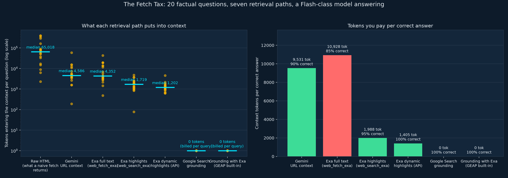

# The Fetch Tax: what each retrieval path puts into an agent's context

Companion experiment to the blog post **The Fetch Tax: Your Agent Asked for a Paragraph. We Handed It the Internet.** (link coming once published).

This is the author's own experiment, not an official Google benchmark.

Twenty factual questions, each with a known answer and the public page it lives on. For every question, seven retrieval paths fetch the evidence, a Flash-class model answers in one sentence, and a regex grades it. We record how many tokens each path pushed into the context window, what it cost at list price (or what the provider itself reported), how long it took, and whether the answer was right.



## Headline results (20 questions, a Flash-class model answering)

| Path | Median tokens into context | Worst case | Accuracy | Tokens per correct answer | Cost per correct answer |
|---|---|---|---|---|---|
| Raw HTML (naive `GET`) | 65,017 | 398,366 | not answered | – | – |
| Gemini URL context | 4,586 | 59,581 | 90% | 9,531 | $0.0091 |
| Exa full text (`web_fetch_exa`) | 4,352 | 43,445 | 85% | 10,928 | $0.0106 |
| Exa highlights (`web_search_exa`, keyless MCP) | 1,719 | 4,779 | 95% | 1,988 | $0.0099 |
| Exa dynamic highlights (API) | 1,202 | 4,545 | 100% | 1,405 | $0.0087 |
| Google Search grounding | 0 | 0 | 100% | 0 (≈2 billable queries per question) | $0.0292 |
| Grounding with Exa (GEAP built-in `exa_ai_search`) | 0 | 0 | 100% | 0 (≈1 billable query per question) | $0.0095 |

**Search-type sweep** (same questions, `highlights: true`, only `type` varies):

| `type` | Accuracy | Median tokens | Median Exa `searchTime` | Measured `costDollars` per call |
|---|---|---|---|---|
| `instant` | 20/20 | 1,878 | 0.32 s | $0.004 |
| `fast` | 20/20 | 1,826 | 0.29 s | $0.007 |
| `auto` | 20/20 | 1,826 | 0.33 s | $0.007 |
| `deep-lite` | 20/20 | 1,697 | 1.51 s | $0.012 |
| `deep` | 20/20 | 1,805 | 5.22 s | $0.012 |
| `deep-reasoning` | 20/20 | 1,653 | 5.19 s | $0.015 |

Read the post for the interpretation. The short version: both model-managed grounding tools on the Gemini Enterprise Agent Platform (Google Search and Exa) were 20/20 with zero tokens in context and bill per model-chosen query; Exa highlights cut the token cost of *reading* by about 7x against page-reading paths; and for single-fact lookups the `type` dial changes only latency and price.

`gemini_exa_grounding` uses Google's documented built-in tool (`types.Tool(exa_ai_search=types.ToolExaAiSearch(api_key=...))`) with default settings. Its cost column counts Exa's search price on your key plus model tokens; any additional platform grounding charge in your agreement is not included.

## Things to know before trusting the numbers

- **Grading is a regex on a one-sentence answer.** It is mechanical and auditable (`questions.json`), not clever. One regex was wrong in the first pass (it rejected "Section 3." because of the full stop); `analyze.py` re-grades from stored answers, so the fix needed no re-run.
- **Empty retrievals are graded as failures.** When a path returned nothing, the model sometimes answered from memory. That isn't the path's doing, so `analyze.py` marks those rows incorrect and flags `retrieval_failed`.
- **The keyless Exa MCP tier dropped calls.** In the first pass 5 of 20 searches came back empty; on the re-run with retries, 7 of 20 needed a retry and one never returned. The API-key paths had zero failures across 140 calls. Both run files are kept.
- **Costs are list prices on 2026-10-13** (the answering model at $0.75/M input, Google Search $14 per 1,000 queries beyond the free 5,000/month, Exa per its published table), except where Exa's response carried `costDollars`, which is used directly.
- **Latency for Google paths includes generation**; Exa's `searchTime` is server-side search only. Don't compare those two columns to each other.
- **Some questions are things the model already knows** (PostgreSQL's port, RFC 6585). They're there to make the token measurement realistic; the accuracy signal comes mostly from the 2026 facts the model cannot know.

## Layout

```
fetch_tax.py        the seven paths, run + probe commands, list prices
type_sweep.py       the same questions through every Exa search type
analyze.py          merge run files, re-grade, summary tables, chart
questions.json      20 questions: canonical URL, regex, expected answer
results/            run files (jsonl), summary.md/json, chart
```

## Run it yourself

Requirements: Python 3.12+, [uv](https://docs.astral.sh/uv/), Node 20 (the MCP client is pure Python, but the config-file route for Antigravity uses `npx`), a Google Cloud project with the Gemini Enterprise Agent Platform enabled and Application Default Credentials, and for the API paths an Exa key (free tier is enough).

```bash
uv sync
export GOOGLE_CLOUD_PROJECT=your-project-id
export EXA_API_KEY=...                     # environment only, never in a file

uv run python fetch_tax.py probe           # one question, every path
uv run python fetch_tax.py run             # 20 questions × 7 paths
uv run python type_sweep.py                # 20 questions × 6 search types
uv run python analyze.py results/runs_*.jsonl --chart results/fetch_tax_chart.png
```

`analyze.py` accepts several run files; later files override earlier rows for the same question and path, which is how a re-run of one path gets spliced in.

The Exa MCP paths use the public endpoint `https://mcp.exa.ai/mcp` (keyless, rate-limited). The dynamic-highlights path calls `/search` directly with the `Exa-Beta: dynamic-highlights-2026-08-28` header.

## Wiring Exa into Google Antigravity

Three routes, all covered in the post: the MCP Store (Agent panel → `…` → MCP Servers → Exa → Install), the config file at `~/.gemini/config/mcp_config.json`, or `npx skills add exa-labs/agent-skills`. The config-file entry used here:

```json
{
  "mcpServers": {
    "exa": {
      "command": "npx",
      "args": ["-y", "exa-mcp-server"],
      "env": { "EXA_API_KEY": "YOUR_KEY" }
    }
  }
}
```

## License

Apache-2.0. See [LICENSE](LICENSE).
