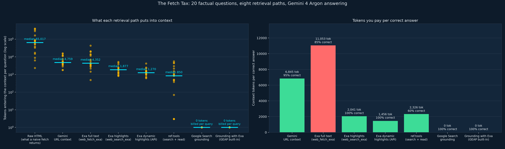
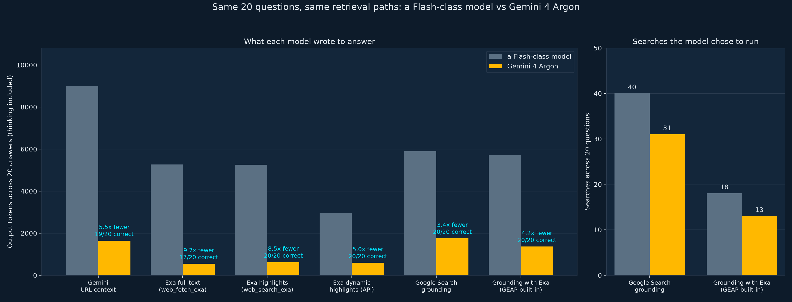

# The Fetch Tax: what each retrieval path puts into an agent's context

Companion experiment to the blog post **The Fetch Tax: In the Argon Era, You Pay It in Compactions** (link coming once published).

This is a personal experiment, prompted by questions customers ask; the conclusions are the author's own.

Twenty factual questions, each with a known answer and the public page it lives on. For every question, eight retrieval paths fetch the evidence, the answering model replies in one sentence, and a regex grades it. We record how many tokens each path pushed into the context window, what it cost at list price (or what the provider itself reported), how long it took, and whether the answer was right.

The main run uses **Gemini 4 Argon** at its default settings. An earlier run with a Flash-class model on the same questions is kept as a before-and-after.



## Headline results (20 questions, Gemini 4 Argon answering)

| Path | Median tokens into context | Worst case | Accuracy | Tokens per correct answer | Cost per correct answer |
|---|---|---|---|---|---|
| Raw HTML (naive `GET`) | 65,017 | 396,757 | measured only | – | – |
| Gemini URL context | 4,759 | 15,507 | 95% | 6,845 | $0.0151 |
| Exa full text (`web_fetch_exa`) | 4,352 | 43,445 | 85% | 11,053 | $0.0237 |
| Exa highlights (`web_search_exa`) | 1,877 | 5,162 | 100% | 2,041 | $0.0113 |
| Exa dynamic highlights (API) | 1,270 | 4,206 | 100% | 1,456 | $0.0101 |
| ref.tools (agent-driven search + read) | 850 | 5,597 | 60% (9 of 13 docs questions) | 2,326 | $0.0074, model tokens only |
| Google Search grounding | 0 reported | 0 | 100% | 0 reported (31 billable queries in 20 questions) | $0.0231 |
| Grounding with Exa (GEAP built-in `exa_ai_search`) | 0 reported | 0 | 100% | 0 reported (13 queries in 20 questions) | $0.0089 |

Full tables, including the per-question breakdown and the documentation-versus-other split, are in [`results/summary_argon.md`](results/summary_argon.md).

## Same benchmark, two models



| Measured on the six paths both runs answered | Flash-class model | Gemini 4 Argon |
|---|---|---|
| Output tokens, thinking included | 34,106 | 6,511 |
| Thinking tokens | 30,903 | 929 |
| Google Search grounding queries (20 questions) | 40 | 31 |
| Grounding with Exa queries (20 questions) | 18 | 13 |
| Correct answers (URL context, full text, highlights, dynamic, Google Search, Exa grounding) | 18, 17, 19, 20, 20, 20 | 19, 17, 20, 20, 20, 20 |

Argon used no thinking tokens on the highlight and full-text paths, and in 140 answers it never stated a wrong value: when a page it read lacked the answer, it replied "not found". With grounding, it answered seven stable facts (PostgreSQL's port, RFC 6585, SemVer and similar) without searching and searched for the rest, including every 2026 price and API detail. The context side did not change between models: highlights used 3.7x less context than page reads at the median on Argon (best of each) and 3.8x on the Flash-class model.

**Search-type sweep on Argon** (same questions, `highlights: true`, only `type` varies):

| `type` | Accuracy | Median tokens | Median Exa `searchTime` | Measured `costDollars` per call |
|---|---|---|---|---|
| `instant` | 20/20 | 1,791 | 0.33 s | $0.004 |
| `fast` | 20/20 | 1,970 | 0.32 s | $0.007 |
| `auto` | 20/20 | 1,853 | 2.35 s | $0.007 |
| `deep-lite` | 20/20 | 1,826 | 1.65 s | $0.012 |
| `deep` | 20/20 | 1,645 | 6.46 s | $0.012 |
| `deep-reasoning` | 20/20 | 1,305 | 6.92 s | $0.015 |

All 120 answers were correct, with 70 thinking tokens spent in total. The Flash-class sweep (`results/type_sweep_20261013_074204.jsonl`) was also 20/20 for every type.

## Flash-class run (consistency check)

| Path | Median tokens into context | Accuracy | Tokens per correct answer |
|---|---|---|---|
| Raw HTML | 65,017 | measured only | – |
| Gemini URL context | 4,586 | 90% | 9,531 |
| Exa full text | 4,352 | 85% | 10,928 |
| Exa highlights (keyless MCP) | 1,719 | 95% | 1,988 |
| Exa dynamic highlights | 1,202 | 100% | 1,405 |
| Google Search grounding | 0 reported | 100% | 0 reported |
| Grounding with Exa | 0 reported | 100% | 0 reported |

Chart: [`results/fetch_tax_chart.png`](results/fetch_tax_chart.png); tables: [`results/summary.md`](results/summary.md).

## Things to know before trusting the numbers

- **Grading is a regex on a one-sentence answer.** It is mechanical and auditable (`questions.json`), not clever. One regex was wrong in the first pass (it rejected "Section 3." because of the full stop); `analyze.py` re-grades from stored answers, so the fix needed no re-run.
- **Empty retrievals are graded as failures.** When a path returned nothing, the model sometimes answered from memory. That isn't the path's doing, so `analyze.py` marks those rows incorrect and flags `retrieval_failed`. The grounding paths are exempt, because deciding whether to search is part of what the tool does.
- **ref.tools is driven the way an agent would drive it.** The answering model writes the query from the tool's own schema guidance ("should include programming language and framework or library names"), picks one search result and reads it; both helper calls are billed to the path. A first version that passed the raw question got "No results found" five times and 9/20; the agent-driven version got 12/20. Both run files are kept, and `analyze.py` lets the later file win. ref.tools is a documentation search, and 7 of the 20 questions are specs, a paper and an encyclopedia entry; its cost covers model tokens only, because ref.tools bills its own plan credits.
- **Grounding with Exa's cost is an upper bound.** It assumes at least one billed Exa search per question; on Argon, nine questions ran no search at all. Any additional platform grounding charge in your agreement is not included.
- **Keyed versus keyless Exa MCP.** The Flash-class run used the keyless hosted tier, where 7 of 20 searches needed a retry and one (q06) never returned. The Argon run authenticated with `--exa-mcp-key` and had no failures.
- **Costs are list prices on the day** (Argon at $2/M input and $10/M output, introductory pricing through 2026-11-30; the Flash-class model at $0.75/M and $3.75/M; Google Search at $14 per 1,000 queries beyond the free allowance; Exa per its published table), except where Exa's response carried `costDollars`, which is used directly. Free allowances are ignored.
- **Latency for Google paths includes generation**; Exa's `searchTime` is server-side search only. Don't compare those two columns to each other.
- **Some questions are things the model already knows** (PostgreSQL's port, RFC 6585). They're there to make the token measurement realistic; the accuracy signal comes mostly from the 2026 facts the model cannot know.

## Layout

```
fetch_tax.py        the eight paths, run + probe commands, list prices, --model
type_sweep.py       the same questions through every Exa search type, --model
analyze.py          merge run files, re-grade, summary tables, chart, --model-label
compare.py          two runs side by side: output tokens and searches per path
questions.json      20 questions: canonical URL, regex, expected answer, domain
results/            run files (jsonl), summaries, charts, run logs
```

## Run it yourself

Requirements: Python 3.12+, [uv](https://docs.astral.sh/uv/), a Google Cloud project with the Gemini Enterprise Agent Platform enabled and Application Default Credentials, an Exa key (free tier is enough) and a ref.tools key.

```bash
uv sync
export GOOGLE_CLOUD_PROJECT=your-project-id
export EXA_API_KEY=...                     # environment only, never in a file
export REF_API_KEY=...

uv run python fetch_tax.py probe --model gemini-4-argon --exa-mcp-key   # one question, every path
uv run python fetch_tax.py run --model gemini-4-argon --exa-mcp-key     # 20 questions × 8 paths
uv run python type_sweep.py --model gemini-4-argon                      # 20 questions × 6 search types
uv run python analyze.py results/runs_gemini-4-argon_*.jsonl \
    --model-label "Gemini 4 Argon answering" \
    --summary results/summary_argon.md --chart results/fetch_tax_chart_argon.png
uv run python compare.py --base results/runs_20261013_*.jsonl \
    --new results/runs_gemini-4-argon_*.jsonl
```

`analyze.py` accepts several run files; later files override earlier rows for the same question and path, which is how a re-run of one path gets spliced in. Without `--model`, the scripts use the Flash-class model.

The Exa MCP paths use the hosted endpoint `https://mcp.exa.ai/mcp`, keyless unless `--exa-mcp-key` sends `EXA_API_KEY` as an `x-api-key` header. The ref.tools path uses `https://api.ref.tools/mcp` with an `x-ref-api-key` header. The dynamic-highlights path calls `/search` directly with the `Exa-Beta: dynamic-highlights-2026-08-28` header.

## Wiring Exa into Google Antigravity

Two routes, both covered in the post: the MCP Store (Agent panel → `…` → MCP Servers → Exa → Install), which uses the keyless hosted server, or Exa's open-source server with your own key in Antigravity's `mcp_config.json` (it opens from the same MCP Servers panel). Exa also publishes an agent skill: `npx skills add exa-labs/agent-skills`. The config-file entry used here:

```json
{
  "mcpServers": {
    "exa": {
      "command": "npx",
      "args": ["-y", "exa-mcp-server"],
      "env": { "EXA_API_KEY": "YOUR_KEY" }
    }
  }
}
```

## License

Apache-2.0. See [LICENSE](LICENSE).
